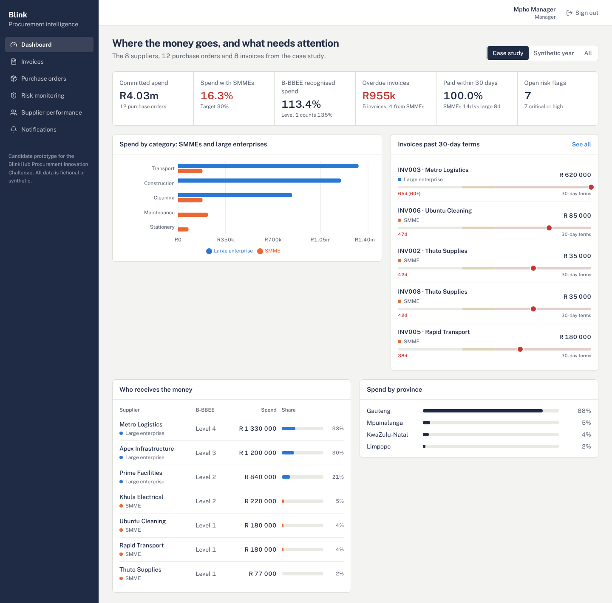
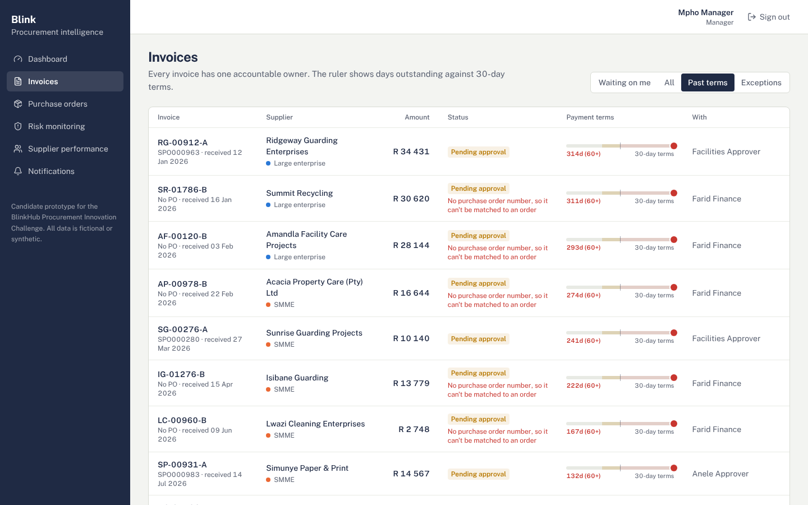
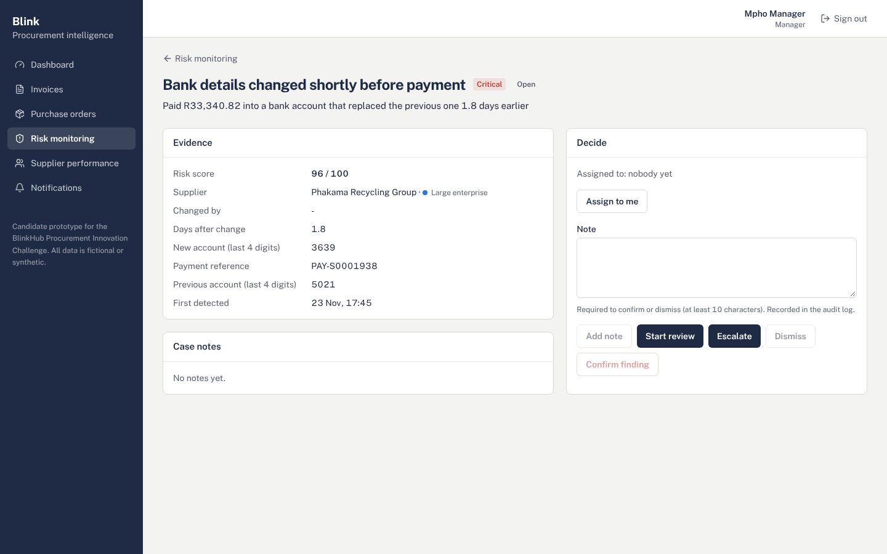

# BlinkHub Procurement Intelligence & Risk Engine

A working prototype for the **BlinkHub Procurement Innovation Challenge** (MICS scenario). It gives Mzansi Infrastructure & Community Services one trustworthy view of the procure-to-pay chain: where the money goes, which invoices are stuck and why, and which transactions need investigating.

> **All data is fictional.** The seed reproduces the case study's sample records exactly. On top of that, a **synthetic demonstration year** is generated (~450 suppliers, ~R85m, deterministic seed) with deliberately planted anomalies. It is labelled as synthetic everywhere and must never be presented as MICS's actual performance.

> **Live demo:** https://16-28-164-172.sslip.io (click any demo user) · **API docs:** https://16-28-164-172.sslip.io/docs
>
> Candidate prototype for ProcureSense's BlinkHub Procurement Innovation Challenge. It is not an official ProcureSense or Blink product.

## Start here (5 minutes)

| To see | Open |
|---|---|
| It working | The [live demo](https://16-28-164-172.sslip.io): sign in as *Mpho, Manager*, then *Ubuntu Cleaning* (supplier portal) |
| The business analysis (Path B) | [`analysis/01_procurement_analysis.ipynb`](analysis/01_procurement_analysis.ipynb): cleaning, 7 investigation questions, findings, recommendations |
| Why it's built this way | [`docs/architecture.md`](docs/architecture.md) (design decisions, business rules, limitations) and [`docs/erd.md`](docs/erd.md) |
| The dashboards | [`powerbi/`](powerbi/) (4-page report and screenshots) and the web app's dashboard |
| How it runs in the cloud | [`docs/aws-deployment.md`](docs/aws-deployment.md) and [`infra/terraform`](infra/terraform) |
| That it works | [`backend/tests`](backend/tests), [`scripts/demo_check.py`](scripts/demo_check.py) and the CI runs under *Actions* |


## Problems addressed

| Case study problem | What this solves |
|---|---|
| 1. Supplier onboarding | CIPC, VAT and CSD format checks; exact duplicates blocked, similar names flagged for review; new suppliers start as *Pending* |
| 2. SMME access | Supplier portal (invoice status, owner, documents, own scorecard); SMME share tracked against a target; overdue SMME invoices tagged as priority. The opportunities marketplace is in the data model; its screens are a next step |
| 3. Where is the money? | Spend by department, supplier, category and province; SMME share; concentration |
| 4. The invoice that never gets paid | Invoice ageing, 30-day SLA ladder, accountable approver, supplier self-service status |
| 5. Contracts and documents | Tax clearance and B-BBEE tracked per supplier, 30-day expiry warnings, upload and verification, automatic reading of certificates. Contracts are in the data model; their screens are a next step |
| 6. Something doesn't look right | Explainable risk flags in an investigation queue: 8 rules + an ML model, with measured precision/recall |
| Blink: "track supplier performance" | Supplier scorecards: delivery, invoice accuracy, compliance, risk record, price |
| 3. Where is the money? (Path B) | dbt star schema (40 data tests), Dagster schedule, **Power BI report**, analysis notebook answering the 7 investigation questions |

Full reasoning: [docs/architecture.md](docs/architecture.md) · Data model: [docs/erd.md](docs/erd.md)

## Quick start (Docker)

Requires Docker Desktop.

```bash
git clone https://github.com/DayDay0308/blinkhub-procurement-intelligence.git
cd blinkhub-procurement-intelligence
cp .env.example .env          # Windows PowerShell: copy .env.example .env
docker compose up --build
```

On first start, the API applies database migrations, loads the case-study data, generates the synthetic year and runs an initial risk scan (about 15 seconds). Set `SEED_SYNTHETIC=false` in `.env` to load only the 8 case-study suppliers.

| What | Where |
|---|---|
| **Web app** (sign in as any demo user) | **http://localhost:8080** |
| Interactive API docs (Swagger) | http://localhost:8000/docs |
| Health check | http://localhost:8000/health |
| PostgreSQL (Power BI, DBeaver) | `localhost:5432` (or the `DB_PORT` you set in `.env`), db `blinkhub`, user/password from `.env` |
| Worker logs (SLA job) | `docker compose logs -f worker` |
| **Dagster** (dbt lineage, runs, schedule) | http://localhost:3000 |
| **Power BI** | double-click `powerbi/blinkhub.pbids`; full guide in [`powerbi/README.md`](powerbi/README.md) |
| **Analysis notebook (Path B)** | [`analysis/01_procurement_analysis.ipynb`](analysis/01_procurement_analysis.ipynb) (renders on GitHub) |

### Check everything works (run before every demo)

```bash
python scripts/demo_check.py        # Windows, if `python` isn't found: uv run --no-project python scripts/demo_check.py
```

This runs the whole story against the running stack the way real users would:
1. all roles sign in
2. the case-study data and its 5 overdue invoices are present
3. a supplier submits an invoice, it's delivered, approved and paid, and the supplier sees the timeline
4. SLA alerts fire
5. the risk scan flags the case-study duplicates, and detection rates hold
6. scorecards are computed
7. supplier compliance finds expired, missing and expiring documents, and reminders aren't repeated
8. Ask BlinkHub answers on its read-only login, and suppliers can't use it
9. the dbt marts match the Power BI check numbers, all 6 containers are up, and the web app reaches the API

26 checks in total.

It prints PASS or FAIL for each step, is safe to run repeatedly, and needs only the Python standard library.

### Demo accounts

All demo users share the password `Demo@2026!` (set by `DEMO_PASSWORD`).

| Email | Role | Sees |
|---|---|---|
| `procurement@mics.demo` | Procurement Officer | Suppliers, POs; registers suppliers |
| `finance@mics.demo` | Finance Officer | All invoices |
| `approver@mics.demo` | Approver | Invoices to approve |
| `manager@mics.demo` | Manager | Everything, dashboards |
| `auditor@mics.demo` | Auditor | Read-only everything |
| `admin@mics.demo` | Admin | Users, rules |
| `accounts@ubuntucleaning.demo` | Supplier | **Only Ubuntu Cleaning's** invoices |
| `accounts@thutosupplies.demo` | Supplier | **Only Thuto Supplies'** invoices |

**Try it in Swagger:** click **Authorize**, sign in as `manager@mics.demo`, then call `GET /api/v1/invoices?overdue=true`. Then sign in as `accounts@ubuntucleaning.demo` and call the same endpoint: the supplier only sees its own two invoices.

## Local development (without Docker for the API)

Uses [uv](https://docs.astral.sh/uv/) for the Python virtual environment.

```bash
docker compose up -d db                 # just the database
cd backend
uv sync                                 # creates .venv with all dependencies
uv run alembic upgrade head             # apply migrations
uv run python -m seed.run               # load case-study data (--reset to reload)
uv run uvicorn app.main:app --reload    # http://localhost:8000/docs
```

In VS Code, select the interpreter at `backend/.venv` (Ctrl+Shift+P → *Python: Select Interpreter*).

### Tests and linting

Tests run against a real PostgreSQL database, because many business rules are database constraints.

```bash
cd backend
uv run pytest            # creates and drops its own blinkhub_test database
uv run ruff check .
uv run ruff format .
```

GitHub Actions runs four jobs on every push: **backend** (lint and 130 tests on PostgreSQL), **analytics** (dbt build with 40 data tests, then Dagster), **frontend** (type check, tests, build) and **Docker** image builds. A separate manual workflow, *Deploy to AWS*, updates the live server.

## What's built

### Invoice workflow (Problem 4)

```
Supplier submits (portal) ─┐
Finance captures (email) ──┴─> 3-way match: PO ↔ goods receipt ↔ invoice
        ├─ exceptions ──> EXCEPTION, owned by Finance, with reasons
        │                  (MISSING_PO_REFERENCE, AWAITING_GOODS_RECEIPT,
        │                   AMOUNT_EXCEEDS_PO, EXCEEDS_GOODS_RECEIVED, PO_NOT_APPROVED)
        └─ clean ──> PENDING_APPROVAL, routed to ONE named approver
                         (limit covers amount, same department first, never the PO requester)
                     ├─ APPROVED ──> Finance owns payment ──> PAID (verified bank account)
                     └─ REJECTED (reason required)
Recording a goods receipt automatically re-matches the invoices waiting on that PO.
```

- **Accountability:** every open invoice has a named owner (`current_owner`).
- **Supplier visibility:** suppliers see a timeline of every step, plus notifications when an invoice is approved, rejected or paid.
- **Payment deadlines:** a Celery beat job runs every 15 minutes and alerts as the 30-day terms approach:
  - day 20: the owner is warned
  - day 25: escalated to managers
  - after day 30: breached, and managers and Finance are alerted
  - SMME invoices are tagged **[SMME priority]**
  - re-running the job never sends duplicate alerts
- **Controls:**
  - row locks prevent double approval or double payment
  - only the assigned approver can approve; a manager can override, but must give a reason
  - each approver has an approval limit
  - whoever changed a supplier's bank details can't release a payment to that supplier within 72 hours
  - bank account numbers are encrypted at rest (pgcrypto)

### API endpoints (`/api/v1`)

| Method | Path | Who |
|---|---|---|
| POST | `/auth/login` · GET `/auth/me` | Everyone |
| GET/POST | `/suppliers` · GET `/suppliers/{id}` | Staff (register: Procurement) · suppliers see own |
| GET | `/invoices` (`status`, `overdue`, `assigned_to_me`, `sort`) | Signed in; suppliers scoped to own |
| POST | `/invoices` | Supplier (portal) · Finance (captured email invoice) |
| GET | `/invoices/{id}` · `/invoices/{id}/timeline` | Same scoping |
| POST | `/invoices/{id}/link-po` | Finance, Procurement |
| POST | `/invoices/{id}/approve` · `/reject` | Assigned approver · Manager override |
| POST | `/invoices/{id}/pay` | Finance |
| GET | `/purchase-orders` | Staff |
| POST | `/purchase-orders/{po}/goods-receipts` | Procurement |
| GET | `/notifications` · POST `/notifications/{id}/read` | Signed in |
| POST | `/jobs/sla-check` | Manager, Admin (also runs on schedule) |
| POST | `/risk/run` · GET `/risk/summary` · `/risk/evaluation` | Manager, Auditor, Admin |
| GET | `/risk/flags` (`status`, `severity`, `rule_code`, `supplier_id`, `assigned_to_me`) · `/risk/flags/{id}` | Staff (never suppliers) |
| POST | `/risk/flags/{id}/status` · `/assign` | Auditor, Manager (closing needs a note; only managers reopen) |
| POST | `/risk/flags/{id}/notes` | Staff |
| GET/PATCH | `/risk/rules` · `/risk/rules/{code}` | Staff view · Admin tunes |
| GET | `/scorecards` · `/suppliers/{id}/scorecard` | Staff · supplier sees own |

### Demo script (Swagger)

1. Sign in as **`accounts@thutosupplies.demo`** and `POST /invoices` with `{"invoice_number": "TS-1001", "po_number": "PO010", "amount": 42000, "invoice_date": "<today>"}`. The result is `EXCEPTION` with the reason `AWAITING_GOODS_RECEIPT`.
2. Submit the same invoice as `ts 1001`. It's blocked with `409`.
3. Sign in as **`procurement@mics.demo`** and `POST /purchase-orders/PO010/goods-receipts` with `{"amount_received": 42000, "received_date": "<today>"}`. The invoice moves to `PENDING_APPROVAL`, owned by Anele (Approver).
4. Sign in as **`approver@mics.demo`**. `GET /invoices?assigned_to_me=true` lists it; `POST /invoices/{id}/approve`.
5. Sign in as **`finance@mics.demo`** and `POST /invoices/{id}/pay`.
6. Back as Thuto, `GET /invoices/{id}/timeline` shows submitted → exception → routed → approved → paid.
7. As **`manager@mics.demo`**, `POST /jobs/sla-check`, then `GET /notifications`. The breached invoices appear, with Ubuntu Cleaning tagged **[SMME priority]**.
8. **Case-study duplicate:** as Finance, link INV002 and then INV008 to PO003 (`/link-po`). The second gets `AMOUNT_EXCEEDS_PO`, because both bill the same R35,000 order.

### Supplier Performance & Risk (Problem 6 + Blink KPI tracking)

**Risk engine:** set-based SQL rules plus an Isolation Forest model. It runs nightly at 02:00 in the worker, or on demand with `POST /risk/run`. Every flag carries its evidence and a plain-English reason, and lands in an investigation queue. Only a person can **confirm** or **dismiss** a flag, and that needs a written note; both actions are recorded in the audit log.

| Rule | Problem 6 example | Logic |
|---|---|---|
| `DUP_INVOICE` | Same invoice twice | Same supplier and amount: on the same PO; or one without a PO within 60 days; or different POs raised within 7 days. Recurring monthly contracts are excluded. Flags the invoice that can't be matched, or the one still to be paid |
| `SPLIT_THRESHOLD` | Payments just below a threshold | 3+ orders from one supplier to one department within 30 days, each at 90–100% of an approval limit |
| `NO_DELIVERY_EVIDENCE` | Paid without delivery documentation | Approved or paid invoice with no PO or no goods receipt |
| `BANK_CHANGE_BEFORE_PAY` | Bank details changed before payment | Paid into an account that replaced the previous one within 14 days |
| `QUOTE_SIMILARITY` | Unusually similar pricing | 3+ quotes with a coefficient of variation below 2% |
| `CONCENTRATION` | Disproportionate share | Top supplier holds more than 40% of a category's 12-month spend (with HHI) |
| `INCOMPLETE_COMPLIANCE` | Incomplete supplier information | Active supplier paid recently without a valid tax clearance |
| `ANOMALY_ML` | Unusual expenditure | Isolation Forest; each flag lists the features driving it, e.g. "18.4x this supplier's typical invoice" |

Thresholds are stored in `risk.rules.params`, and an Admin can tune them with `PATCH /risk/rules/{code}` without a deploy.

**Measured, not claimed.** The synthetic generator plants labelled anomalies of each type (`synthetic.anomaly_labels`), and `GET /risk/evaluation` scores the engine against them:

| | Planted | Caught | Recall | Precision |
|---|---|---|---|---|
| 7 SQL rules | 109 | 109 | **100%** | **95–100%** per rule |
| ML (Isolation Forest) | 15 | 14 | 93% | about 56–58%: a second opinion, which is why it's paired with rules |
| **Overall** | **124** | **123** | **99.2%** | **about 89–90%** (92–93% counting real problems caught by another rule) |

The demo year is generated relative to today's date, so precision moves by a point or so between runs; the live figures are on the Risk page ("How accurate is it?"). CI fails if any SQL rule drops below 95% recall or precision (`tests/test_synthetic_detection.py`).

**Supplier scorecards** (`GET /scorecards`, `GET /suppliers/{id}/scorecard`) give each supplier a score from 0 to 100 and a grade from A to E, weighted as follows:
- delivery reliability: 30%
- invoice accuracy: 25%
- compliance: 20%
- risk record: 15%
- price compared with the market median for the same item: 10%

KPIs with no data are re-weighted. Suppliers with no activity show `N/A`, so they're never ranked above suppliers with a real track record. Suppliers can see their own scorecard.

#### Risk demo (Swagger)

1. Sign in as **`auditor@mics.demo`** and call `GET /risk/flags`. The queue is sorted by score, with bank-change and split-order cases at the top.
2. Call `GET /risk/flags?rule_code=DUP_INVOICE`. This includes the **case-study duplicates**: INV008 (matches INV002) and INV006 (matches INV001, already paid).
3. Open a flag, then `POST /risk/flags/{id}/status` with `{"status": "CONFIRMED", "note": "..."}`. Without a note, the request is rejected.
4. Call `GET /risk/evaluation` for the precision and recall table, then `GET /scorecards?supplier_type=SMME` for the SMME ranking.

### Supplier compliance (Blink compliance module)

Every active supplier needs a **valid tax clearance** and a **B-BBEE certificate or sworn affidavit**. For each one the system works out a state:

| State | Meaning |
|---|---|
| Expired | the last verified document has passed its expiry date |
| Missing | nothing verified has ever been received |
| Waiting for verification | uploaded, not yet checked by procurement |
| Expiring soon | verified, but expires within 30 days (`COMPLIANCE_WARNING_DAYS`) |
| Valid | verified and in date |

- **Upload:** suppliers (or procurement) upload a PDF, PNG or JPG up to 5 MB. The file type is checked from its content, not its name, and the same file can't be uploaded twice.
- **Verify:** procurement opens the file, copies the issue and expiry dates from it, and marks it verified, or sends it back with a reason the supplier sees. **Whoever uploaded a document can't verify it.** Every step is in the audit log.
- **Daily check (06:00, Celery):** marks documents past their date as expired and reminds the supplier and procurement, once per document.
- **Connected:** the `INCOMPLETE_COMPLIANCE` risk rule flags payments to suppliers without a valid tax clearance, and the scorecard's compliance KPI (20%) uses the same documents.
- Endpoints: `GET /compliance/overview`, `GET|POST /suppliers/{id}/documents`, `POST /compliance/documents/{id}/verify|reject`, `GET /compliance/documents/{id}/file`, `POST /jobs/compliance-check`.
- Files are stored in a Docker volume locally; on AWS they go to S3.
- **Test files:** `demo-documents/` has fictional certificates watermarked *DEMONSTRATION ONLY* (regenerate with `uv run --with reportlab python scripts/make_demo_documents.py`).

Demo: sign in as **Thuto Supplies** → My documents (B-BBEE expired, tax clearance expiring in 12 days) → upload `demo-documents/Thuto_Supplies_BBBEE_Certificate_DEMO.pdf` → sign in as **Palesa (procurement)** → Supplier compliance → Check document → verify → Thuto is valid again.

### AI features (work without a key; better with one)

Set `ANTHROPIC_API_KEY` in `.env` to use an AI model; leave it empty and both features fall back to rules. If the AI service is slow or down, they fall back automatically.

**Reading certificates.** When a document is uploaded, BlinkHub reads the company name, document type, B-BBEE level, reference number, and issue and expiry dates:

| | Without a key | With a key |
|---|---|---|
| Method | The PDF's own text and labelled-field rules | The PDF or photo goes to the AI model, which answers through a fixed JSON schema |
| Works on | Typed PDFs | Typed PDFs, scans and phone photos |

It then checks the result against what's expected: name matches the supplier, right kind of document, not expired, dates in order. The verify form is pre-filled, and a document that fails a check opens on *Send it back*. **A person still verifies every document:** the AI suggests, procurement decides.

**Ask BlinkHub.** Staff ask questions in plain English ("Which SMMEs in Limpopo have been waiting longest to be paid?") and get a table they can download as CSV, with the SQL shown. Without a key, 11 saved questions work. Three layers keep it safe:

1. **The API:** staff only; every question and its SQL go to the audit log.
2. **The SQL check** (`sqlglot`): exactly one `SELECT`, only the `ask` views, no session or server functions, at most 200 rows.
3. **The database:** generated SQL runs on a **separate read-only login** (`blinkhub_ask`) that can only read curated views. These leave out bank details, password hashes and contact details, and every session is read-only with a 5-second timeout. Tests prove the login itself refuses what might slip past the checks: other tables, switching to the app's user, writes, long queries.

### Procurement Intelligence (Problem 3, Path B)

**Analysis notebook:** [`analysis/01_procurement_analysis.ipynb`](analysis/01_procurement_analysis.ipynb). It starts from the case-study tables *exactly as printed* ("R85,000", "KZN"), then:
- cleans and validates them with 6 data-quality checks
- answers all **7 investigation questions** with charts
- extends the analysis with the synthetic year, clearly labelled
- ends with findings, 8 costed recommendations, and assumptions and limitations

**dbt** (`analytics/dbt`) builds a star schema in the `analytics` schema:
- **Dimensions:** `dim_supplier` (with B-BBEE procurement recognition, Level 1 = 135%), `dim_date` (SA fiscal year Apr–Mar), `dim_department`, `dim_category`.
- **Facts:**
  - `fct_purchase_orders` (spend)
  - `fct_invoices` (days to pay, ageing, paid within terms)
  - `fct_deliveries` (on-time)
  - `fct_risk_flags` (value at risk)
- **Marts:** monthly KPIs, Pareto/ABC supplier ranking, HHI concentration.
- **Tests:** 40 data tests, including *every rand of PO spend reconciles to the app*, *no invoice paid before it was received* and referential integrity. A dbt **exposure** documents the Power BI dependency.
- **Every row carries `data_source`** (`CASE_STUDY` or `SYNTHETIC`), so no report can mix up real and demo data without saying so.

**Dagster** (`analytics/orchestration`) turns each dbt model into an asset with full lineage. It's scheduled daily at **03:00**, after the worker's 02:00 risk scan. The UI is at http://localhost:3000.

**Power BI** (`powerbi/`) has a four-page report spec:
1. Executive overview
2. Spend & SMME
3. Invoice performance
4. Risk & supplier performance

The kit includes a one-click connection file (`.pbids`), a theme, 30+ DAX measures (SMME share, B-BBEE recognition, HHI, days-to-pay gap, value under review…) and the expected numbers to check against.

### Other business rules (with tests)

- **Supplier onboarding:**
  - CIPC, VAT and CSD formats are validated.
  - Exact duplicates are blocked.
  - Similar names need acknowledgement.
  - New suppliers start as `PENDING`.
- **Enforced by the database:**
  - Duplicate invoice numbers per supplier are blocked, whatever the formatting.
  - A PO's requester can't approve it.
  - A `PAID` invoice must have a payment date.
  - The audit log is append-only and hash-chained.
- **Security:**
  - Passwords are hashed with Argon2id.
  - Sign-in uses JWT tokens.
  - Login errors don't reveal which accounts exist.
  - The app refuses to start outside local/test with the default secret.
  - Errors use one consistent JSON format.

### Web app

React + TypeScript (Vite), Tailwind CSS, TanStack Query, React Router and Recharts, served by nginx in Docker at **http://localhost:8080**. nginx proxies `/api` to the FastAPI container, so the browser talks to one origin.

| Screen | Who | What it does |
|---|---|---|
| Sign in | everyone | Email/password, or one click per demo role |
| Dashboard | staff | Spend, SMME share vs 30% target, B-BBEE recognition, overdue value, days-to-pay gap, risk. Toggle **Case study / Synthetic year / All** |
| Invoices | staff | Waiting on me, past terms, exceptions; capture an emailed invoice |
| Invoice detail | staff, supplier | 30-day terms ruler, plain-language match exceptions, history, approve / reject / pay / link PO |
| Purchase orders | staff | Delivered vs invoiced per order; record a delivery (re-matches waiting invoices) |
| Risk monitoring | auditor, manager… | Queue by pattern, evidence, case notes, assign, confirm/dismiss (note required); **accuracy tab** with recall and precision |
| Supplier performance | staff | A–E scorecards with 5 KPIs; register a supplier with a duplicate-name warning |
| Ask BlinkHub | staff | Questions in plain English → table + SQL + CSV |
| Supplier compliance | staff | Expired, missing and expiring documents; check uploads; run the daily check |
| Supplier portal | supplier | My invoices with status and owner, submit an invoice, my documents, my scorecard |
| Notifications | everyone | Day-20 reminders and day-25 escalations |

The signature element is the **30-day payment-terms ruler**: every invoice shows where it sits against the day-20 reminder, day-25 escalation and day-30 deadline, so Problem 4 is visible at a glance.

Design choices: Public Sans with tabular figures; ink navy for structure; SMME orange and large-enterprise blue are the same series colours as the Power BI report; green/amber/red only ever mean state. Works down to phone width.





## Repository layout

```
backend/
  app/            FastAPI app: api/ routes, core/ config+security+errors, models/, schemas/,
                  services/ (business rules: workflow, sla, suppliers, audit, scorecard,
                  compliance, extraction, ask, storage, risk/ rules + ML + evaluation),
                  worker.py (Celery)
  migrations/     Alembic; schema lives in reviewed SQL files (migrations/sql)
  seed/           case_study.py (exact sample data) · synthetic.py (demo year + planted anomalies)
  tests/          pytest suite (real PostgreSQL)
analytics/        dbt project (staging -> marts) + Dagster orchestration
analysis/         Path B notebook, raw case-study CSVs, synthetic snapshot
infra/terraform/  AWS: EC2 + Elastic IP, private S3 bucket, IAM roles, SSM, budget alert, GitHub OIDC
deploy/           Production compose override, Caddy (HTTPS), bootstrap and update scripts
demo-documents/   Fictional certificates (watermarked) for testing uploads
frontend/         React + TypeScript web app (Vite, Tailwind, TanStack Query), nginx Dockerfile
powerbi/          Power BI connection file, theme, DAX measures, report (.pbix), screenshots
docs/             Architecture, ERD, design viewer
.github/workflows CI (4 jobs) and the manual AWS deploy
```

## Roadmap

1. ~~Foundation: schema, auth and roles, seed, Docker, CI~~
2. ~~Invoice workflow: supplier submission, 3-way match, approval routing, SLA scheduler (Celery + Redis)~~
3. ~~Risk engine: 8 explainable rules + Isolation Forest; investigation queue; precision/recall on labelled synthetic data; supplier scorecards~~
4. ~~Spend intelligence: dbt star schema + tests, Dagster, Power BI report, analysis notebook (Path B)~~
5. ~~React + TypeScript frontend: internal console and supplier portal~~
6. ~~AWS deployment kit (Terraform, HTTPS, S3, budget alert, OIDC deploy); Ask BlinkHub; certificate reading~~ (see [docs/aws-deployment.md](docs/aws-deployment.md))

**Next steps**

- Multi-tenancy: a `buyer_org_id` on every table with PostgreSQL row-level security, so many Blink buyers share one platform
- Screens for opportunities (the SMME marketplace) and contracts, which are already in the data model
- Read emailed invoices automatically, using the same document reading as certificates
- Production AWS: ECS Fargate, RDS Multi-AZ, Secrets Manager, CloudFront with WAF, Claude through Amazon Bedrock
- Staff single sign-on, and email or WhatsApp notifications
- Test with MICS finance staff and SMME suppliers

## Assumptions and limitations

See [`backend/seed/case_study.py`](backend/seed/case_study.py) (`ASSUMPTIONS`) and [docs/architecture.md §9](docs/architecture.md).
