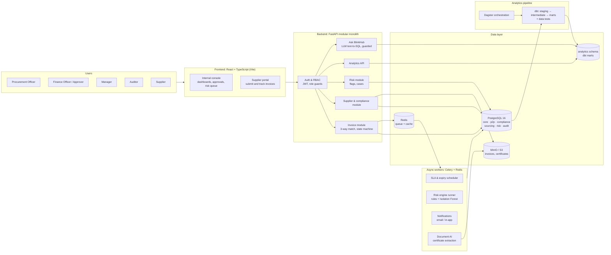

# BlinkHub Procurement Intelligence & Risk Engine: Solution Architecture

> Candidate submission for the BlinkHub Procurement Innovation Challenge (MICS scenario).
> All data is **fictional or synthetic, for demonstration only**. Results from synthetic data are never presented as MICS's real performance.

## 1. Problem statement

MICS spends **R85m a year** across 450 suppliers, but its procurement data is spread across spreadsheets, mailboxes and separate PO and invoice systems. In the sample data provided:

- **3 large enterprises receive 84% of the listed spend**, while SMMEs receive 16%.
- **5 of 8 invoices are outstanding past 30 days** (R955k). The SMMEs wait 38–47 days; large suppliers were paid in 8–15.
- **2 invoices look like possible duplicates** (Thuto INV002/INV008; Ubuntu INV006 matches a PO that has already been paid).
- **No invoice carries a PO reference**, so nothing can be matched automatically.

**Chosen focus:** Problems 3, 4 and 6 (*Where is the money? The invoice that never gets paid. Something doesn't look right.*). Underneath, these are one problem: **no single, trustworthy view of the procure-to-pay chain**. Without it, money cannot be tracked, invoices cannot be paid on time, and risk cannot be caught.

**Why these three:** they share one data spine (supplier → PO → goods receipt → invoice → payment), the sample data provides evidence for all three, and fixing them has a direct rand value: late-payment harm to SMMEs, duplicate payments, and leakage.

## 2. Solution overview

A BlinkHub module with four capabilities:

| Capability | Business problem | What it does |
|---|---|---|
| **Invoice Tracker** | P4 | Suppliers submit invoices on a portal; 3-way match (PO ↔ GRN ↔ invoice); approval routing to a named approver; SLA clock and escalation; supplier sees payment status |
| **Risk Engine** | P6 | Explainable rules + anomaly model produce *flags for investigation*, each with reason codes, assignment and case notes |
| **Spend Intelligence** | P3, P2 | Automated dbt marts → dashboard: spend by department/supplier/category/province, concentration (HHI), SMME and B-BBEE share, budget burn, regional price variance |
| **Ask BlinkHub** (AI) | P3 | Natural-language questions over the read-only analytics marts ("Which SMMEs have been waiting longest?") with SQL shown for transparency |

## 3. Architecture

### Key design decisions

| Decision | Choice | Why | Trade-off accepted |
|---|---|---|---|
| Service shape | **Modular monolith** | One deployable unit is right for a prototype and a small team; module boundaries (invoice, supplier, risk, analytics) map to future services | Must scale as one unit; can split later along the same boundaries |
| OLTP vs analytics | **Same Postgres, separate schemas** (`p2p` vs `analytics`) | Dashboards never compete with transactional tables; one database to operate | At real scale, move marts to a warehouse (e.g. Snowflake/BigQuery/DuckDB). dbt makes that a config change |
| Transformations | **dbt** | Version-controlled SQL, tests (`unique`, `not_null`, relationships), lineage docs. Replaces "monthly manual reports" | Extra tool to learn; worth it for reliability |
| Orchestration | **Dagster** | Asset-based: each mart is a visible asset with freshness checks | Airflow is more common; Dagster fits a data-asset model better |
| Risk detection | **Rules first, ML second** | Rules are explainable and auditable (needed when people's reputations are involved); Isolation Forest catches patterns no rule anticipated | ML gives a score, not a reason, so every ML flag is paired with the features that drove it |
| Duplicate invoices | **Prevent + detect** | Unique index on (supplier, normalised invoice no.) blocks exact repeats at submission; fuzzy rule catches near-duplicates (same amount, same PO, different number) | Fuzzy matches produce some false positives; that is why they go to review, not auto-rejection |
| Audit | **Append-only, hash-chained log** in Postgres | Any edited or deleted history breaks the chain, so tampering is detectable (fraud context) | Not a blockchain; trust still rests on DB administrators |
| Documents | **Object storage (MinIO, S3-compatible)** + SHA-256 per file | DB stays small; identical file re-uploads detected | One extra container |
| Sensitive data | Bank account numbers **encrypted**; UI shows last 4 digits only | POPIA; bank-detail fraud is a named risk | Key management is simplified in the prototype |

## 4. Core business rules

1. **3-way match:** an invoice moves to approval only if it references an approved PO, a goods receipt exists, and invoice amount ≤ received amount (within a tolerance, default 2%). Otherwise → `EXCEPTION` with a reason.
2. **Always an accountable owner:** every non-final invoice has a `current_approver_id`. Approval routes by department and the approver's `approval_limit`.
3. **Payment SLA:** an invoice's due date defaults to 30 days from receipt. Escalation at day 20 (to the approver), day 25 (to the manager) and day 30 (breach, on the dashboard). SMME invoices get a priority flag.
4. **Segregation of duties:** whoever raises a PO cannot approve it (enforced in the database); whoever changes bank details cannot release a payment within 72 hours of the change.
5. **Compliance gate:** a supplier with an expired tax clearance or B-BBEE document cannot receive new POs (payment of existing work continues, so suppliers are not punished for admin lag).
6. **Flags, not accusations:** risk output is always `OPEN` for review. Only a human can mark a flag `CONFIRMED` or `DISMISSED`, with a case note.

## 5. Risk rules (explainable)

| Code | Detects | Logic (summary) | Case-study link |
|---|---|---|---|
| `DUP_INVOICE_EXACT` | Same supplier, same normalised invoice no. | Blocked at submission | "Two invoices with same number and amount" |
| `DUP_INVOICE_FUZZY` | Same supplier + amount within N days, or invoice for an already-paid PO | Amount match + date window + trigram similarity | Thuto INV002/INV008, Ubuntu INV006 |
| `SPLIT_THRESHOLD` | Payments just below an approval limit | ≥ 3 transactions in 30 days within 90–100% of a threshold | "Several payments just below threshold" |
| `NO_DELIVERY_EVIDENCE` | Invoice paid or approved without a GRN | Left join to `goods_receipts` | "Paid despite incomplete delivery documentation" |
| `BANK_CHANGE_BEFORE_PAY` | Bank details changed shortly before payment | Change within 14 days of payment | "Banking details changed shortly before payment" |
| `QUOTE_COLLUSION` | Unusually similar quotes | Coefficient of variation across quotes < 2% | "Unusually similar pricing" |
| `CONCENTRATION` | One supplier dominating a category | Supplier share > 40% of category, or category HHI > 2,500 | "Disproportionately large share" |
| `ANOMALY_ML` | Unusual spend patterns | Isolation Forest on amount, frequency, timing and supplier-age features | "Unusual expenditure patterns" |

**Proving it works:** the synthetic data generator plants labelled anomalies of each type. The test suite and the dashboard report **precision and recall per rule**, so detection is measured, not just claimed.

## 6. Technology stack

| Layer | Technology |
|---|---|
| Frontend | React 18, TypeScript, Vite, TanStack Query, React Router, Tailwind + shadcn/ui, Recharts |
| Backend | Python 3.12, FastAPI, Pydantic v2, SQLAlchemy 2, Alembic migrations |
| Auth | JWT (access + refresh), role-based guards, supplier users row-scoped to their own supplier |
| Database | PostgreSQL 16 (pgcrypto, pg_trgm) |
| Async | Celery + Redis (SLA scheduler, risk runs, notifications) |
| Analytics | dbt-core (dbt-postgres), Dagster |
| ML / AI | scikit-learn (Isolation Forest), LLM API for document extraction and Ask BlinkHub |
| Storage | MinIO (S3-compatible) |
| Quality | pytest, Playwright (E2E), dbt tests, Ruff, mypy, ESLint |
| Delivery | Docker Compose (one command), GitHub Actions CI (lint → test → build) |
| Observability | Structured JSON logs, `/health` and `/metrics` endpoints |

## 7. Roles and access

| Role | Can |
|---|---|
| Supplier | Submit invoices; see only their own invoices, payments and documents |
| Procurement Officer | Manage suppliers, POs, goods receipts; view risk flags |
| Finance Officer / Approver | Approve or reject invoices within their limit; schedule payments |
| Manager | All dashboards; reassign approvals; escalation target |
| Auditor | Read-only everything, including the audit log and risk cases; update flag status |
| Admin | Users, rules and thresholds |

## 8. Delivery plan

| Phase | Scope |
|---|---|
| 1. Foundation | Repo, Docker Compose, schema + migrations, synthetic data generator (sample data + expansion), auth |
| 2. Invoice Tracker | Submission, 3-way match, approval routing, SLA scheduler, supplier status view |
| 3. Risk Engine | Rules, Isolation Forest, flags API, investigation queue UI, precision/recall evaluation |
| 4. Spend Intelligence | dbt marts + tests, Dagster, management dashboard |
| 5. Stretch | Ask BlinkHub, certificate document AI, CI/CD polish |
| 6. Presentation | Findings on the provided sample, demo script, limitations, next steps |

## 9. Limitations and assumptions

- The sample has no dates, PO references on invoices, GRNs or quotations, so the synthetic expansion invents these, and every such assumption is documented.
- A 30-day payment standard is assumed (common practice and the PFMA norm for the public sector; MICS's actual terms are unknown).
- Risk thresholds are starting values, to be tuned with MICS data and auditor feedback.
- Not production-grade: no SSO, simplified key management, single-node deployment.
