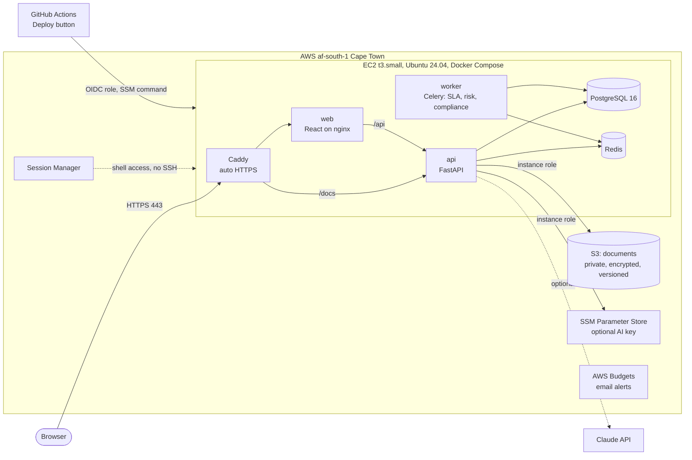
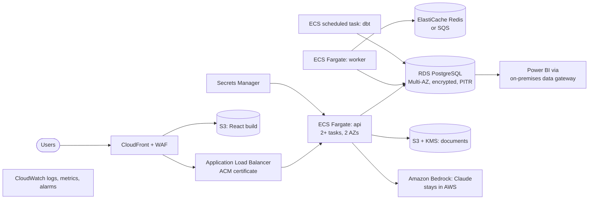

# Deploying BlinkHub on AWS

Two designs: the **demo deployment** that `infra/terraform` builds today (one server, about
US$27 a month), and the **production target** it would grow into for a real ProcureSense
client. Both run the same containers.

## 1. Demo deployment (what Terraform builds)



| Choice | Why |
|---|---|
| One EC2 server with Docker Compose | Identical to local development; fits the Free Tier (t3.small) and a demo budget |
| Cape Town region (af-south-1) | Supplier data (tax numbers, B-BBEE, bank details) stays in South Africa, which supports POPIA |
| Caddy in front | Free, automatic Let's Encrypt certificates; HTTPS without buying a domain (`<ip>.sslip.io`) |
| Only ports 80 and 443 open | Database, API and Redis have no public ports. **No SSH port**: shell access is through Session Manager, logged in CloudTrail |
| Instance role, no access keys | The server reaches S3 and SSM with temporary credentials; IMDSv2 required |
| Secrets generated on the server | Database, JWT, encryption and read-only-login passwords are created at first boot into `/opt/blinkhub/.env` (mode 600) and never leave it |
| S3 for documents | Private, encrypted (SSE-S3), versioned; old versions expire after 30 days |
| Budget alert | Email at 50%, 80% and 100% of US$20, and when the month's forecast passes it |
| GitHub OIDC deploy role | The Deploy workflow assumes a role that can only run commands on this one server; no AWS keys in GitHub |

### Cost (on-demand, Cape Town, running 24/7)

| Item | ~US$/month |
|---|---|
| EC2 t3.small ($0.0271/hour) | 20 |
| 30 GB gp3 disk | 3–4 |
| Elastic IP (public IPv4) | 3.65 |
| S3, SSM, Budgets | < 1 |
| **Total** | **≈ 27** |

The US$100 Free Tier credit covers about 3–4 months. **Stopping** the server between demos
cuts this to about US$7 a month (disk and IP only); it comes back on the same address.
Check current prices with the [AWS Pricing Calculator](https://calculator.aws/).

## 2. Step by step (Windows, no software to install)

Everything runs in **AWS CloudShell**, a terminal inside the AWS console, so no AWS keys go
on your laptop.

**Before you start**

1. **Make the GitHub repository public** (the server clones it): GitHub → your repo →
   Settings → General → Danger Zone → Change visibility → Public. Check first that no
   `.env` file was ever committed (`git log --all -- .env` should print nothing).
2. **Enable the Cape Town region:** AWS console → your name (top right) → Account →
   *AWS Regions* → Africa (Cape Town) → **Enable**. It takes a few minutes. If you can't
   enable it, use `eu-west-1` (Ireland) in step 4 instead.

**Deploy**

3. In the AWS console click the **CloudShell** icon (top bar, `>_`). Then paste:

   ```bash
   # Terraform (one time)
   mkdir -p ~/bin && cd ~/bin
   curl -sLO https://releases.hashicorp.com/terraform/1.9.8/terraform_1.9.8_linux_amd64.zip
   unzip -o terraform_1.9.8_linux_amd64.zip && rm terraform_1.9.8_linux_amd64.zip
   grep -q 'HOME/bin' ~/.bashrc || echo 'export PATH=$HOME/bin:$PATH' >> ~/.bashrc
   export PATH=$HOME/bin:$PATH && terraform -version

   # The code
   cd ~ && git clone https://github.com/DayDay0308/blinkhub-procurement-intelligence.git
   cd blinkhub-procurement-intelligence/infra/terraform
   cp terraform.tfvars.example terraform.tfvars
   nano terraform.tfvars
   ```

4. In `nano`, put your email in `alert_email`, and the region you enabled. Leave
   `anthropic_api_key` commented out unless you have a key. Save with **Ctrl+O, Enter**,
   exit with **Ctrl+X**.

5. Build it:

   ```bash
   terraform init
   terraform validate
   terraform plan          # read it: about 15 resources to add, nothing to destroy
   terraform apply         # type: yes
   ```

   At the end Terraform prints the `url`, for example `https://13-245-10-20.sslip.io`.

6. **Wait about 10–15 minutes** while the server installs Docker and builds the images. To
   watch: EC2 console → Instances → `blinkhub-web` → **Connect** → **Session Manager** →
   Connect, then:

   ```bash
   sudo tail -f /var/log/blinkhub-bootstrap.log   # Ctrl+C to stop watching
   ```

   It's ready when the log ends with `== Done. Open https://...`.

7. Open the `url`, click a demo user, and run through the demo. `url/docs` is the API
   documentation.

**Optional: one-click deploys from GitHub**

8. In `terraform.tfvars` set `github_repo = "DayDay0308/blinkhub-procurement-intelligence"`,
   run `terraform apply` again, then in GitHub → Settings → Secrets and variables →
   Actions → **Variables** add `AWS_DEPLOY_ROLE_ARN` (from `terraform output
   github_deploy_role_arn`), `AWS_INSTANCE_ID` (`terraform output instance_id`) and
   `AWS_REGION`. After pushing changes: Actions → **Deploy to AWS** → Run workflow.

## 3. Running it

| Task | How |
|---|---|
| See what's running | Session Manager: `cd /opt/blinkhub && sudo docker compose -f docker-compose.yml -f deploy/docker-compose.prod.yml ps` |
| Logs | same, with `logs -f api` (or `worker`, `caddy`) |
| Update to the latest code | Deploy workflow, or `sudo /opt/blinkhub/deploy/update.sh` |
| Add the AI key later | `aws ssm put-parameter --name /blinkhub/anthropic_api_key --type SecureString --value sk-ant-...`, then on the server `sudo bash /opt/blinkhub/deploy/bootstrap.sh` |
| Pause to save money | EC2 → Instances → Instance state → **Stop** (Start brings it back on the same URL) |
| Remove everything | CloudShell: `cd ~/blinkhub-procurement-intelligence/infra/terraform && terraform destroy` |
| Power BI against the cloud database | Not exposed on purpose. Use the local stack, or a Session Manager port forward to 5432 |

**If HTTPS doesn't come up:** `logs caddy` usually says why. Let's Encrypt needs port 80
reachable and occasionally rate-limits shared names like sslip.io; wait an hour, or set
`domain` to a domain you own (point an A record at the IP) and `terraform apply`.

## 4. Production target for a real client



What changes and why:

- **Fargate instead of one server:** no machines to patch, two Availability Zones, rolling
  deploys from images in ECR built by CI.
- **RDS PostgreSQL Multi-AZ:** automated backups with point-in-time recovery, failover, and
  encryption with KMS. Same schema and Alembic migrations.
- **Secrets Manager** with rotation instead of a generated `.env`.
- **CloudFront + WAF** in front: caching for the React app and protection against common
  attacks and bots.
- **Claude through Amazon Bedrock:** the AI features call a model inside the client's AWS
  account and region, with IAM instead of an API key. Only `app/services/ai.py` changes.
- **Multi-tenancy:** `buyer_org_id` on every table plus PostgreSQL row-level security, so
  many Blink buyers share one deployment without seeing each other's data.
- **Observability:** CloudWatch alarms on API errors, queue depth and the SLA job; AWS
  Backup for RDS and S3; CloudTrail and GuardDuty switched on.

## 5. The same design on Azure and Google Cloud

| Need | AWS | Azure | Google Cloud |
|---|---|---|---|
| Single VM (demo) | EC2 | Virtual Machines | Compute Engine |
| Containers without servers | ECS Fargate | Container Apps | Cloud Run |
| Managed PostgreSQL | RDS / Aurora | Database for PostgreSQL Flexible Server | Cloud SQL |
| Redis | ElastiCache | Azure Cache for Redis | Memorystore |
| File storage | S3 | Blob Storage | Cloud Storage |
| Secrets | Secrets Manager / SSM | Key Vault | Secret Manager |
| Load balancer + certificates | ALB + ACM | Application Gateway / Front Door | Cloud Load Balancing |
| CDN + WAF | CloudFront + WAF | Front Door + WAF | Cloud CDN + Cloud Armor |
| Shell without SSH | Session Manager | Bastion | IAP TCP forwarding |
| CI deploy without stored keys | IAM OIDC role | Workload identity federation | Workload Identity Federation |
| Managed AI model | Bedrock | Azure AI Foundry | Vertex AI |
| Cost alerts | Budgets | Cost Management budgets | Billing budgets |
| South African region | Cape Town (af-south-1) | South Africa North (Johannesburg) | Johannesburg (africa-south1) |
| Infrastructure as code | Terraform (or CDK) | Terraform (or Bicep) | Terraform |
