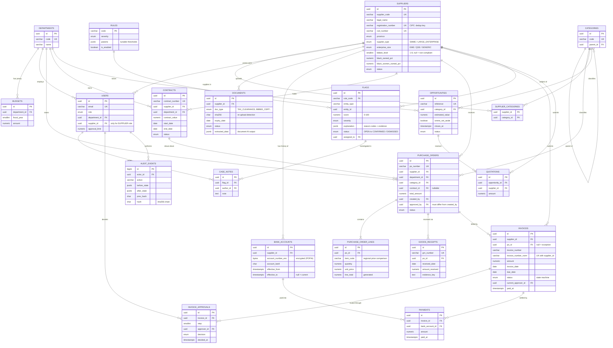

# Entity Relationship Diagram

21 tables in 6 PostgreSQL schemas. The full DDL is in [`backend/migrations/sql/0001_initial_schema.sql`](../backend/migrations/sql/0001_initial_schema.sql). Analytics marts (`analytics` schema) are generated by dbt and are not shown.

## Design notes

| Feature | Business problem it solves |
|---|---|
| `registration_number`, `vat_number` and `csd_number` are unique; trigram index on `legal_name` | Duplicate supplier profiles (P1) |
| `invoices.po_id` nullable, but a null PO sends the invoice to `EXCEPTION` | Invoices missing PO references (P4) |
| Unique `(supplier_id, invoice_number_norm)`: normalisation strips spaces and dashes, so `INV-001` = `inv 001` | Duplicate invoices (P4, P6) |
| `current_approver_id` on every open invoice | "Finance cannot determine who is responsible" (P4) |
| `goods_receipts` table | 3-way match; payment without delivery evidence (P6) |
| `bank_accounts` keeps history (`effective_from` / `effective_to`) | Bank details changed before payment (P6) |
| `purchase_order_lines.item_code` | Paying different prices for the same item across regions (P3) |
| `contracts.contract_value` + POs linked to contracts | Spend against contract, expiry tracking (P5) |
| `opportunities.smme_set_aside` + `quotations` | SMME access (P2); quote-similarity detection (P6) |
| `risk.flags` unique per (rule, entity) | Re-running the engine never duplicates flags |
| `audit.events` append-only and hash-chained | Tamper-evident history for investigations |
| `CHECK (approved_by <> created_by)` | Segregation of duties enforced by the database, not just the UI |

## Added in later migrations

| Migration | Change | Why |
|---|---|---|
| 0002 | `p2p.invoices.match_exceptions text[]` | Stores the 3-way-match result (e.g. `AWAITING_GOODS_RECEIPT`) |
| 0002 | `core.notifications` (unique per user + kind + entity) | In-app alerts; the SLA job can re-run without spamming |
| 0003 | `p2p.purchase_orders.expected_delivery_date` | Delivery-reliability KPI |
| 0003 | `risk.flags.last_seen_at`, `resolved_by`; seeded `risk.rules` with tunable `params` | Engine bookkeeping; thresholds changeable without a deploy |
| 0003 | `synthetic.anomaly_labels` (separate schema) | Answer key for planted anomalies in the demo data, so precision and recall can be measured. Kept apart from operational data |
| 0004 | `compliance.documents.uploaded_by`, `original_filename`, `content_type`, `size_bytes`, `rejection_reason`; unique (supplier, file hash) | Traceable uploads, reasons suppliers can act on, no duplicate files |
